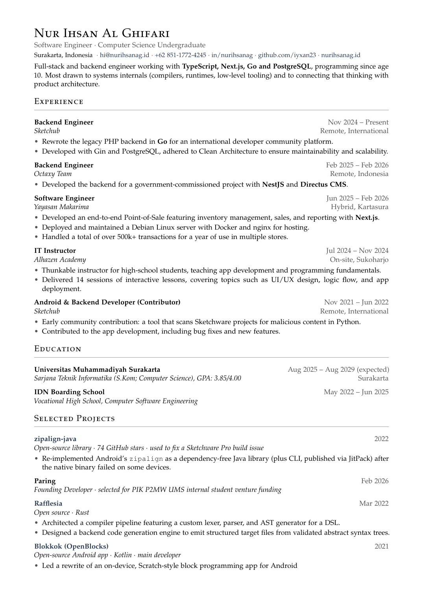
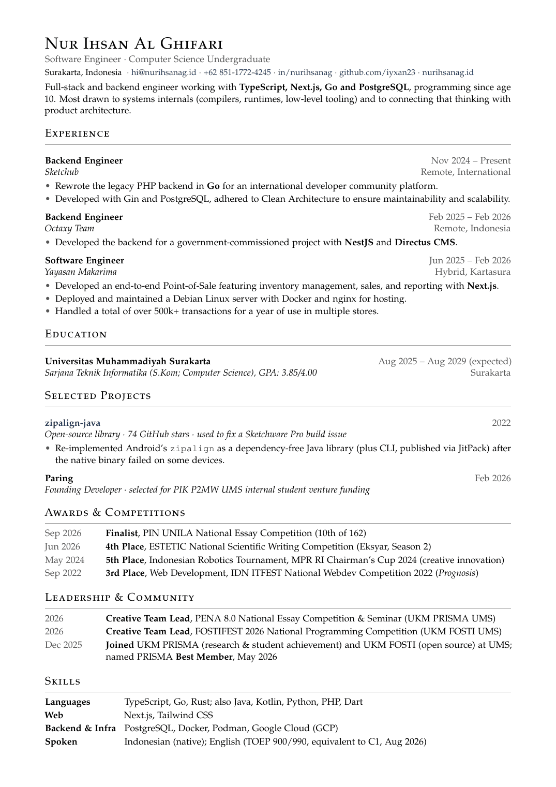
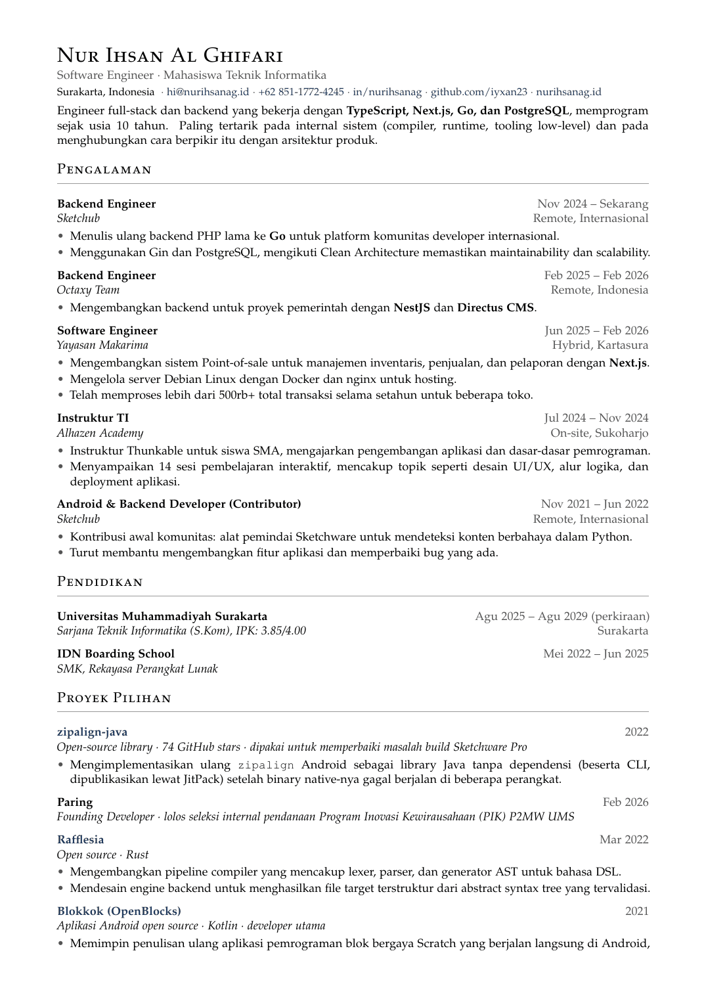

# CV — a data-driven, multilingual LaTeX CV builder

[](https://opensource.org/licenses/MIT)
[](https://creativecommons.org/licenses/by/4.0/)
[](https://www.python.org/downloads/)
[](https://ctan.org/pkg/latexmk)

One TOML file holds every word of the CV. One TeX file holds the entire layout.
A single dependency-free Python script turns them into every PDF you need:
**full and short variants, in every language, compiled in parallel.**

| Full · English | Short · English | Full · Bahasa Indonesia |
| --- | --- | --- |
|  |  |  |

## Features

- **Single source of truth** — content lives in `cv.toml`, appearance lives in `cv.tex`.
  Nothing personal ever touches the layout file.
- **Variants from priorities** — tag every item `priority = 1 | 2 | 3`; each variant
  keeps everything up to its `max_priority`, so the one-page CV and the full CV can
  never drift apart.
- **Translations in place** — `title_id` sits next to `title`, `bullets_id` next to
  `bullets`. Missing translations fall back to English and are reported by
  `./build.py --missing`.
- **Zero LaTeX knowledge needed to edit content** — write `**bold**`, `*italic*`,
  `` `code` `` and `[label](url)`; LaTeX special characters are escaped for you.
- **Localized dates** — `"2024-05"` becomes `May 2024` in English and `Mei 2024`
  in Indonesian, with per-language month names and the word *Present* / *Sekarang*.
- **Fast rebuilds** — all variant × language jobs compile concurrently via `latexmk`,
  plus a `--watch` mode.
- **No dependencies to install** — `build.py` uses only the Python ≥ 3.11 standard library.

## Requirements

| Tool | Why | Install (Debian/Ubuntu) |
| --- | --- | --- |
| Python ≥ 3.11 | `tomllib`, used by `build.py` | `sudo apt install python3` |
| `latexmk` + pdfLaTeX | compiles the PDFs | `sudo apt install latexmk texlive-latex-recommended texlive-fonts-recommended` |
| Indonesian babel patterns | hyphenation for the `-id` build | `sudo apt install texlive-lang-other` |
| `pdfinfo` *(optional)* | prints page counts after each build | `sudo apt install poppler-utils` |

The template uses Palatino (`mathpazo`), `enumitem`, `microtype` and `hyperref`,
all of which ship with the packages above. Without the Indonesian language file the
build still succeeds — non-English text is simply not hyphenated.

## Quick start

```sh
git clone <this repository>
cd <repository>

./build.py          # or: make
```

PDFs land in `dist/`:

```
dist/Nur-Ihsan-Al-Ghifari-CV.pdf          # full, English
dist/Nur-Ihsan-Al-Ghifari-CV-id.pdf       # full, Indonesian
dist/Nur-Ihsan-Al-Ghifari-CV-short.pdf    # short, English
dist/Nur-Ihsan-Al-Ghifari-CV-short-id.pdf # short, Indonesian
```

## Commands

### `build.py`

| Command | Effect |
| --- | --- |
| `./build.py` | build every variant in every language |
| `./build.py short` | one variant (or several: `./build.py full short`), all languages |
| `./build.py -l id` | every variant, Indonesian only (`-l` is repeatable) |
| `./build.py --watch` | rebuild whenever `cv.toml` or `cv.tex` changes (Ctrl-C to stop) |
| `./build.py --missing` | list every field that still lacks a translation; exits `1` if any |
| `./build.py --tex-only` | generate `build/*-content.tex` without running LaTeX |
| `./build.py clean` | remove `build/` and `dist/` |

Unknown variant or language names are rejected with the list of valid ones, and a
LaTeX failure prints only the relevant log excerpt.

### `Makefile`

| Target | Equivalent to |
| --- | --- |
| `make` | `./build.py` |
| `make full` / `make short` | `./build.py full` / `./build.py short` |
| `make watch` | `./build.py --watch` |
| `make clean` | `./build.py clean` |

## How it works

```
cv.toml  ──build.py──▶  build/cv-<variant>-<lang>-content.tex
cv.tex   ──latexmk───▶  build/cv-<variant>-<lang>.pdf  ──▶  dist/<filename><suffix>.pdf
```

`build.py` renders the chosen sections of `cv.toml` into a fragment that calls a
handful of layout macros (`\cvheader`, `\cvsection`, `\cvhead`, `\cvrow`, …).
`cv.tex` defines those macros and `\input`s the fragment — one template, one
fragment per job, compiled in parallel.

### Repository layout

| Path | Role | Edit? |
| --- | --- | --- |
| `cv.toml` | all CV content, variants, languages, translations | **yes — this is the file you edit** |
| `cv.tex` | layout only: fonts, margins, colours, macros | yes, if you want a different look |
| `build.py` | renders TOML → TeX and drives `latexmk` | rarely |
| `Makefile` | thin convenience wrapper | rarely |
| `build/` | generated fragments, logs, intermediate PDFs (git-ignored) | never |
| `dist/` | final PDFs (git-ignored) | never |
| `docs/` | preview images shown above | regenerated, see below |

## Configuration reference (`cv.toml`)

### Variants

```toml
[variants.full]
max_priority = 3                    # keep items with priority <= 3
filename = "Nur-Ihsan-Al-Ghifari-CV"

[variants.short]
max_priority = 1                    # essentials only -> one page
filename = "Nur-Ihsan-Al-Ghifari-CV-short"
```

Output path = `dist/<filename><language suffix>.pdf`.

### Priorities

`priority` works on any item, bullet and section (default `1`):

| Value | Meaning |
| --- | --- |
| `1` | essential — appears in every variant |
| `2` | nice to have |
| `3` | only on the full CV |

Sections render in the order written; reorder freely. Hide a section without
deleting it with `enabled = false`.

### Languages

```toml
[languages.en]                      # first entry = default language
babel = "english"
present = "Present"
months = ["Jan", "Feb", …, "Dec"]

[languages.id]
suffix = "-id"                      # -> …-CV-id.pdf
babel = "indonesian"
present = "Sekarang"
months = ["Jan", "Feb", …, "Des"]
```

The default language needs no suffix and no `_<lang>` keys — its text *is* the key.

### Meta (header)

```toml
[meta]
name = "Nur Ihsan Al Ghifari"
tagline = "Software Engineer · Computer Science Undergraduate"
tagline_id = "Software Engineer · Mahasiswa Teknik Informatika"
contacts = [
  { text = "hi@nurihsanag.id", url = "mailto:hi@nurihsanag.id" },
  { text = "github.com/iyxan23", url = "https://github.com/iyxan23" },
]
```

Contacts are joined with `·`; `url` is optional and renders as a link.

### Sections

Every section has a `type` and a translatable `title` (empty title = no heading):

| `type` | Renders | Extra keys |
| --- | --- | --- |
| `text` | one free-form paragraph | `text` |
| `entries` | title + organisation + dates + bullets (experience, education, projects) | `item` |
| `rows` | hanging-indent rows: date/label on the left, text on the right (awards, skills) | `item`, `label_width` (e.g. `"3.0cm"`) |

An `entries` item:

```toml
[[section.item]]
title = "Backend Engineer"
org = "Sketchub"                    # italic line
where = "Remote, International"     # right-aligned on the same line
url = "https://…"                   # optional: makes the title a link
start = "2024-11"
end = "present"                     # localized via [languages].present
bullets = [ "…", "…" ]
priority = 1
```

A `rows` item uses `date` (or `start`/`end`) plus `text`, or a bold `label` plus
`text`:

```toml
[[section.item]]
date = "2026-09"
text = "**Finalist**, PIN UNILA National Essay Competition (10th of 162)"

[[section.item]]
label = "Languages"
text = "TypeScript, Go, Rust; also Java, Kotlin, Python, PHP, Dart"
```

### Dates

Dates are quoted strings: `"2024-11"`, `"2026-09-16"`, `"2022"`, `"present"`.
`start`/`end` render as `Nov 2024 – Present`; `date` renders a single value.
When a date doesn't fit the pattern (a range, a GPA window, “expected”), use the
free-form `when` instead:

```toml
when = "Aug 2025 -- Aug 2029 (expected)"
when_id = "Agu 2025 -- Agu 2029 (perkiraan)"
```

### Inline markup

Available in any text field:

| You write | You get |
| --- | --- |
| `**bold**` | **bold** |
| `*italic*` | *italic* |
| `` `code` `` | monospace |
| `[GitHub](https://github.com/…)` | hyperlink |
| `& % $ # _ { } ~ ^` | escaped automatically — type them literally |

### Translations

Anything longer than a couple of words gets a sibling key suffixed with the
language code:

```toml
title = "Experience"
title_id = "Pengalaman"

bullets = [ "First point.", "Second point." ]
bullets_id = [ "Pertama.", "Kedua." ]   # same length and order as `bullets`
```

- Missing translation → falls back to the default language.
- `./build.py --missing` lists every field still in English, per language.
  Text fields shorter than three words (names, places, URLs) are skipped; dates
  and month names come from `[languages]`. Every untranslated bullet list is
  flagged.
- A `bullets_id` whose length doesn't match `bullets` is reported alongside the
  missing fields — priorities are read from the default-language list, so the two
  lists must stay aligned.

### Adding a language

1. Add a `[languages.<code>]` block with `babel`, `present` and `months`
   (and a `suffix` if it isn't the first language).
2. Add the babel language to `cv.tex` (see the `\ifcvbabel` block) so hyphenation
   patterns load; if you skip this, the text still builds without hyphenation.
3. Translate with `<key>_<code>` keys, then run `./build.py --missing` until it
   reports `complete`.

## Changing the layout

Everything visual lives in `cv.tex`: page geometry, the accent colour (`accent`),
the muted grey, fonts (Palatino), section rules, and the macro bodies
(`\cvheader`, `\cvsection`, `\cvhead`, `\cvsub`, `\cvtext`, `\cvrow`). Edit a
macro once and every language and variant picks it up.

`build.py` never writes to `cv.tex`, and `cv.tex` never contains personal data —
the two can evolve independently.

## Using this repository for your own CV

1. Replace the contents of `cv.toml` (`[meta]`, sections, variants, languages).
2. Tweak `filename` under each `[variants.*]` so the output PDFs are named for you.
3. Adjust colours/typography in `cv.tex` if you want a different identity.
4. Run `./build.py --missing`, then `./build.py`.

The generated `docs/preview-*.png` images can be refreshed with:

```sh
pdftoppm -png -r 130 -f 1 -l 1 dist/<name>.pdf docs/preview-full-en
mv docs/preview-full-en-1.png docs/preview-full-en.png   # pdftoppm appends the page number
```

## Troubleshooting

| Symptom | Fix |
| --- | --- |
| `latexmk not found` | install TeX Live — see [Requirements](#requirements) |
| Indonesian text isn't hyphenated | `sudo apt install texlive-lang-other` (provides `babel-indonesian`) |
| `cv.toml error: …` | TOML syntax mistake — the message includes the line number |
| `cv.toml is missing a required field: …` | an item lacks a key the renderer needs (e.g. `max_priority` on a variant) |
| `unknown variant(s): …` / `unknown language(s): …` | typo in a target or `-l` value; the error lists the valid names |
| Build fails but the message is unreadable | re-run and read `build/<job>.log`, or use `./build.py --tex-only` to check the generated TeX |
| Page count keeps growing | lower `max_priority`, or add `priority = 2/3` to the less essential items |

## Contributing

Typo fixes in `cv.toml` and improvements to `build.py` / `cv.tex` are welcome —
please keep the split intact: **no personal data in `cv.tex`, no layout in
`cv.toml`.** Open an issue first for anything larger than a typo.

## License

- **Code** — `build.py`, `cv.tex`, `Makefile` and build tooling are licensed under
  the [MIT License](https://opensource.org/licenses/MIT).
- **Content** — the CV content in `cv.toml`, the generated PDFs and the preview
  images in `docs/` are licensed under
  [CC BY 4.0](https://creativecommons.org/licenses/by/4.0/): share and adapt them
  freely, with attribution.
